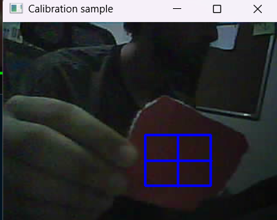
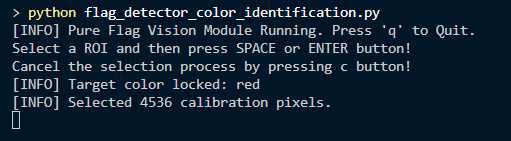
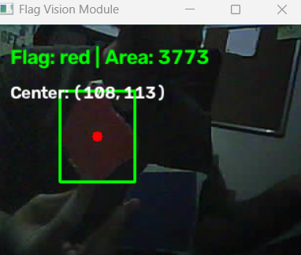
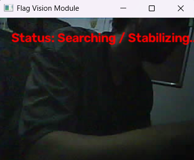

# UGV Computer Vision — ESP32-CAM Flag Detection

An OpenCV development prototype for detecting a colored flag from an ESP32-CAM video stream. It reports the detected color and image position and draws a bounding box and center marker.

This README documents the original detector and the improvements added during camera integration and testing. The ESP32-CAM streams video; the Python detector currently runs on a computer. Terminal announcements and optional USB Serial messages are implemented. Wi-Fi communication, the ESP32 LCD receiver, motor control, and standalone deployment are still pending.

## Project structure

```text
UGV-Computer-Vision-/
├── flag_detector_color_identification.py  # Main loop, preview and keyboard controls
├── settings.json                         # Shared HSV profiles and filters
├── vision/
│   ├── __init__.py
│   ├── camera.py                         # Stream opening with OpenCV defaults
│   ├── detector.py                       # Masks, blobs and four-frame confirmation
│   ├── calibration.py                    # Sample selection and color lock
│   └── settings.py                       # JSON loading and existing validation
├── communication/
│   ├── __init__.py
│   ├── lcd_announcer.py                  # Once-per-event output; optional USB Serial
│   └── wifi_client.py                    # Placeholder; Wi-Fi sender not implemented
├── docs/
│   ├── screenshots/
│   └── control_interface.md              # Proposed Wi-Fi message contract
├── requirements.txt
├── tests/test_lcd_announcer.py            # Offline announcement and cleanup checks
├── README.md
└── .gitignore
```

Keep launching the original main filename. It imports helpers from `vision`; do not launch the helper files individually. Settings load from this project's `settings.json` even when the terminal is in another directory. Explicit paths passed to `load_settings(path)` are still supported.

The reorganization removes an unused `time` import, an unreachable legacy fixed-pixel filter, and an extra HSV conversion/reshape used only to count sample pixels. The pixel count now comes directly from the sample dimensions. Detection thresholds and confirmation rules are retained. The optional `r` reload shortcut, automatic reconnection and explicit camera timeout settings were subsequently removed by user request; `c` and `q` remain available. `communication/wifi_client.py` is a documented placeholder and sends nothing; see [the proposed control interface](docs/control_interface.md).

## Detection pipeline

```text
ESP32-CAM stream → Gaussian blur → HSV conversion → color masks
→ mask cleanup → contour filtering → largest valid blob
→ four consecutive same-color detections → displayed result
```

Before a target is selected, the detector compares all configured colors. After a successful sample selection, it checks only the selected color profile. Within that profile it still selects the largest valid blob.

## What changed

| Change | Purpose |
| --- | --- |
| ESP32-CAM MJPEG input instead of the laptop webcam | Process the robot camera's video. |
| Minimum area as a fraction of image area | Make the noise threshold scale with resolution rather than use a fixed pixel count. |
| Optional aspect-ratio filter | Allow testing without assuming fixed flag proportions. |
| Adjusted red HSV thresholds and 3×3 processing kernels | Recover the dim, low-saturation practice target that the original settings missed; retain smaller details during cleanup. |
| `c`: select a sample and lock its recognized color | Restrict detection to the color chosen from the camera image. |
| Normalized horizontal error display | Show whether the confirmed flag is left, centered, or right, using the same scale at different image widths. |
| Camera failure handling | Clear old detections and exit after 30 consecutive failed reads; automatic reconnection and explicit timeouts have been removed. |
| Flag-color announcement | Announce confirmed colors once per event in the terminal; optionally send the teammate's LCD message over USB Serial. |

The existing four-detection stabilizer is retained. It confirms a color after four consecutive successful same-color results, rather than after four seconds. It does not verify that those results belong to the same physical object.

## Why we added calibration controls

### Problem 1: a red target was visible but not detected

During testing, a red practice target appeared dark and desaturated in the ESP32-CAM image. The original red profile required saturation `S >= 120`. A sampled region of the saved target image had saturation values around 53–68, so it fell outside that profile.

Changing the minimum target size alone did not fix the miss. A diagnostic check showed that the loaded red profile still used `S = 120`. After editing the actual loaded `settings.json` to use a red saturation minimum of 45 and value minimum of 40, the user reported successful detection.

These are starting values for our tested setup, not universal red thresholds. Lighting, exposure, camera color response, and the material all affect the recorded HSV values. Lowering thresholds can also admit unwanted background pixels, so negative tests are required.

### Problem 2: the detector could choose a different color

The original detector compared all configured colors and selected the largest valid blob. A larger object matching another color profile could therefore become the reported result.

The `c` workflow lets the operator select a region inside the intended flag. The existing detector identifies a configured color in that region, and subsequent frames are checked only against that color profile. If the selected color disappears, the program searches instead of switching to another configured color.

### What calibration currently does

- Edit and save `settings.json`, then restart Python to apply changed HSV ranges or other settings. The `r` reload shortcut has been removed.
- `c` captures a clean frame, opens a rectangular sample selector, counts its pixels, and identifies a color using the existing profiles.
- A recognized sample sets the target color for the current session.
- An unrecognized or cancelled sample preserves the previous selection. If no target was selected previously, all-color detection continues.
- The stabilizer resets after the sample-selection workflow and after failed camera reads.

**The current `c` implementation does not calculate new HSV thresholds or save calibration to JSON.** Automatic range estimation is a future step. A sample outside the existing profiles can still be unrecognized, and overlapping profiles can produce an incorrect color label.

## Setup and run

Requirements: an ESP32-CAM with CameraWebServer firmware already running, a computer with Python and a graphical desktop, OpenCV, NumPy, and network access to the camera.

From the repository directory, install the Python packages into the environment you intend to use:

```powershell
python -m pip install -r requirements.txt
```

Check the camera's current IP address in the Arduino Serial Monitor at 115200 baud after reset. Update `camera_url` in `flag_detector_color_identification.py` if the address has changed. Its format is:

```text
http://<camera-ip>:81/stream
```

Close any browser camera stream before starting the detector. From the repository directory, run:

```powershell
python flag_detector_color_identification.py
```

A microSD card is not required for this live-stream workflow. `requirements.txt` pins the GUI-enabled OpenCV and NumPy versions from the current development environment. A fresh installation from these pins has not yet been tested. Keep the main file and both packages together when sharing the project.

## Flag announcement and optional LCD output

Adapted from the teammate's `Updated` commit (`1545dff`). By default, a confirmed flag prints:

```text
FLAG DETECTED
COLOR: RED
```

Repeated confirmed detections of the same color produce no additional announcement. Ten consecutive unconfirmed updates allow another announcement; failed camera reads also count. This threshold counts updates, not seconds. A different confirmed color or a new `c` selection attempt also permits a new announcement. Confirmation still requires four detections.

`USE_ESP32 = False` in the main file keeps hardware output disabled. Terminal mode does not need pySerial. For a separate USB bench test, install `python -m pip install pyserial`, set `LCD_SERIAL_PORT` to the control ESP32's actual port and enable `USE_ESP32`. This sends `FLAG_DETECTED,RED\n` at 115200 baud; the ESP32 firmware must parse it and update the physical LCD. `COM5` is only a placeholder. USB Serial is not the planned Wi-Fi transport.

The optional Serial port has one-second read/write limits and a two-second boot wait; these do not restore camera timeout options. Serial setup errors stop startup with an error. A write failure prints a warning, closes the port and continues with terminal announcements. Camera and Serial resources are closed on exit.

No target-lost message is sent and the LCD is not cleared by this Python feature. It is an announcement channel, not a continuous steering signal or motor watchdog. Hardware display behavior has not been tested.

Run the offline checks from the repository directory:

```powershell
python -m unittest discover -s tests -v
```

Serial API reference: [pySerial documentation](https://pyserial.readthedocs.io/en/latest/pyserial_api.html).

## Keyboard controls

Use an English keyboard layout and focus the **Flag Vision Module** window before pressing a key.

| Key | Action |
| --- | --- |
| `q` | Exit the detector. |
| `c` | Open the **Calibration sample** window and choose a target-color sample. |

To select a sample:

1. Place the target in the actual operating lighting.
2. Press `c` in the video window.
3. Drag a rectangle inside one color on the target. Exclude the background, edges, deep shadows, and strong glare.
4. Press Enter to confirm, or press `c` in the selector to cancel.
5. Check the terminal for the result. Example output, with a sample-dependent pixel count:

```text
[INFO] Target color locked: red
[INFO] Selected 2000 calibration pixels.
```

6. Wait for four subsequent successful detections of that color before expecting a confirmed box.

The selector intentionally displays a still image. Press `c` again in the main video window to select a different target color. Restarting the program clears the selection. Settings are loaded at startup only. After changing `settings.json`, restart Python and select the target again if needed.

If settings cannot be loaded at startup, the program prints an error and exits. Validation is incomplete; not every malformed value is rejected before detection starts.

## Horizontal position for control integration

For a confirmed detection, the preview displays `X error`. The image midpoint is `(width - 1) / 2`, and the error is `(flag_center_x - midpoint) / midpoint`. A single-column image uses zero to avoid division by zero.

- `-1`: left edge of the image.
- Near `0`: centered in the image.
- `+1`: right edge of the image.

This value is currently calculated and displayed only for confirmed detections. It is not yet transmitted to the control ESP32 or used to command motors. The control team must agree on communication and steering behavior before integration.

## Camera failure handling

The stream opens once with `cv2.VideoCapture(url)` using OpenCV defaults. There are no application-configured opening/read timeouts and no automatic reconnection. Backend defaults may still apply; a blocked opening or read has no application-defined time limit and can delay `q` or error handling.

When a read returns failure, confirmation resets and the preview replaces the old detection with `Camera unavailable`. After 30 consecutive failed reads, the program exits and releases the capture. The threshold counts failed reads, not seconds. `q` is checked after reads return, including during the failed-read wait.

Restart Python to open a new stream after a connection failure. If the camera's IP changes, update `camera_url` first. A temporary failed read followed by successful reads on the same capture can still recover naturally, but the application does not reopen it. Four new same-color detections are required after a failed read.

## Current settings

| Setting | Current value | Meaning |
| --- | --- | --- |
| `min_flag_area_ratio` | `0.001` | Minimum contour area is 0.1% of the processed image area: about 76.8 pixels² at 320×240. This is a noise threshold, not a physical flag-size estimate. |
| `aspect_ratio_range` | `null` | No restriction on the bounding box width/height ratio. |
| `kernel_size` | `3` | Morphological cleanup uses a 3×3 kernel. |
| `blur_kernel_size` | `3` | Gaussian smoothing uses a 3×3 kernel. |

Current practice red profile, inside `colors` in `settings.json`:

```json
"red": {
  "lower1": [0, 45, 40],
  "upper1": [10, 255, 255],
  "lower2": [170, 45, 40],
  "upper2": [179, 255, 255]
}
```

Red uses two intervals because its hue crosses the ends of OpenCV's standard 8-bit hue range, 0–179. Red is a practice color; the competition color must not be assumed in advance.

## Screenshots and live evidence

The following four user-supplied screenshots document the sample selection, recognition, detection, and target-absent stages. Images are stored under `docs/screenshots/` beside this README. These individual captures do not establish continuous performance or a measured accuracy score.

### 1. Selecting a calibration sample

The operator opened the **Calibration sample** window and drew a blue selection rectangle inside the red practice target, excluding the surrounding background. The still image allows a sample to be selected before confirmation with Enter. This capture documents the selection interface; it does not yet establish that the color was recognized or locked.



### 2. Confirmed target-color selection

After confirming the sample, the terminal reported `Target color locked: red` and `Selected 4536 calibration pixels.` This live capture confirms that the selected sample was recognized as red and the target-color selection was set. It does not demonstrate automatic HSV estimation or yet prove behavior with distractors.



### 3. Selected target with a different-colored distractor

After the red sample was selected, the live display reported `Flag: red | Area: 3773` and `Center: (108, 113)`. The green bounding box surrounds the red paper, while a dark blue-looking object is visible below it without a detection box. This documents the displayed result for this scene. The image does not establish that the other object matches a configured profile or has a larger valid contour; the stronger larger-distractor test remains pending.



### 4. Selected color removed

Following the instruction to remove the red paper while retaining the running session, the user supplied this capture. No red paper or detection box is visible, and the display shows Searching / Stabilizing. This is an observed target-absent result. The earlier dark blue-looking object is not clearly visible here, so the screenshot does not establish rejection of a visible wrong-color distractor. A short recording or repeated observations would provide stronger evidence of continued behavior.



## Verification record

| Check | Evidence / status |
| --- | --- |
| ESP32-CAM input | User confirmed moving live video after correcting the camera IP. |
| Announcement integration | Nine offline tests passed on 2026-10-18: repeat suppression, ten-update rearming, color/sample changes, exact Serial bytes, optional setup/cleanup, write-failure fallback, main-loop failed reads and real detection on synthetic frames. No physical LCD or USB device test performed. |
| Dim red target after manual HSV changes | User reported successful detection. |
| Historical `r` shortcut | Previously reported working; removed by user request. Restart Python to apply saved settings. |
| Current source and detection helpers | Offline check on 2026-10-17: source parsed; solid synthetic red, green, blue, and yellow samples recognized. |
| Folder reorganization and cleanup | Offline regression check on 2026-10-18: 70 synthetic detection comparisons matched the committed detector; simulated selection, cancellation, rejection and replacement passed; full-loop previews, logs and capture lifecycle matched through `c`, `r`, failed reads and recovery. Settings loaded correctly from another working directory. No live camera test was performed for this refactor. |
| Color restriction logic | Offline check on 2026-10-17: selected red ignored a larger blue region; removing red produced no detection. |
| Confirmation logic | Offline check on 2026-10-17: confirmed on the fourth same-color detection and reset on a no-detection result. |
| Historical reconnection implementation (removed) | Simulated main-loop checks on 2026-10-18 passed for recovery, selected-color retention, four new detections after recovery, a cleared offline display, five failed attempts, `q` cancellation, and capture cleanup. These checks describe the removed implementation; current failure-exit behavior is tested separately. |
| Live `c` sample-selection interface | User supplied a screenshot of the selector with a rectangle inside the red practice target. |
| Live sample recognition and target-color lock | User supplied terminal evidence: `Target color locked: red` and `Selected 4536 calibration pixels.` |
| Live red detection after sample selection | Screenshot reports red, contour area 3773, center (108, 113), with a dark blue-looking object below and no box on it. This is one observed scene. |
| Selected target absent | User supplied a screenshot showing Searching / Stabilizing with no red paper or detection box visible. This supports the observed frame, not long-run false-positive performance. |
| Larger valid different-color distractor | Stronger live evidence pending; the target-absent screenshot does not clearly show the other object. |

The offline checks exercised the current helper functions with synthetic images in a separate test environment. They do not establish real-camera accuracy or verify keyboard and ROI-window behavior.

For each live test, record: test ID, lighting, resolution, selected color, target/distractor arrangement, steps, expected result, actual result, pass/fail, and evidence filename. Do not mark a case as passed until it has been run.

## Other problems encountered

| Problem | Response and remaining limitation |
| --- | --- |
| Old camera IP timed out | Read the new address in Serial Monitor and update the stream URL. The source is still hard-coded. |
| Browser preview froze | Stopped the old stream and changed JPEG quality from 10 to 20 at 320×240 to reduce traffic. A bounded stream test completed without disconnecting; long-run stability is not established. Camera settings may reset after reboot. |
| Missing `min_flag_area_ratio` | Updated the actual settings file loaded by the process. Duplicate project folders and relative paths made this confusing. |
| Syntax/indentation errors while adding shortcuts | Aligned `if`/`elif` branches and restored the missing `build_mask(...)` call. |
| Key appeared unresponsive | Check window focus, English keyboard layout, saved code, and whether the stream is still advancing. The exact cause of the reported incident was not confirmed. |

## Remaining work

- Estimate and validate new HSV ranges from samples, including circular red hue handling; add reviewed persistence to JSON.
- Test lighting changes, multiple flag sizes, no flag, wrong colors, and same-color distractors. There is no measured accuracy score yet.
- Improve settings validation; the default settings path now resolves from the project directory.
- Live-test camera loss, exit after failed reads, manual restart and changed IP addresses. Measure blocking and latency with backend defaults. Add stale-frame detection; a stream that returns old frames can still appear readable.
- Agree the controller interface and confirm the allowed processing architecture. The current laptop prototype does not demonstrate standalone competition operation.
- Integrate image-position output with control. The ultrasonic sensor, rather than apparent flag size, must provide the mission's distance measurement.

Color selection is not physical-object tracking: another object matching the selected profile can still be detected. Terminal color announcement and optional Serial output are implemented; Wi-Fi control integration, the physical LCD receiver and the 50 cm control task remain pending.

## Recorded implementation commits

| Commit | Change |
| --- | --- |
| `f721969` | Read ESP32-CAM video stream. |
| `68d0dd8` | Adjust practice red settings and make size filters configurable. |
| `cf36d2a` | Historically added `r` settings reload; this shortcut has since been removed. |
| `6fa884f` | Select a color sample and restrict detection to its recognized color. |
| `45a544b` | Reset confirmation after a failed frame read. |
